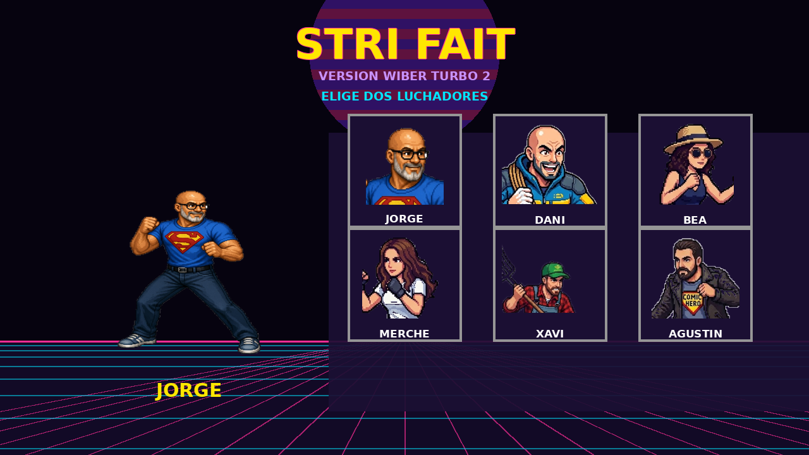

# STRI FAIT — Version Wiber Turbo 2

Juego de pelea 2D hecho en el navegador con **Phaser 3** (CDN) y **JavaScript puro, sin build**.



## 100% Vibe Coding

Este proyecto ha sido creado **100% con vibe coding**, usando:

- **[opencode](https://opencode.ai)** + **DeepSeek** para el código.
- **Gemini** para generar las imágenes de los personajes.
- **Suno** para el audio / la música de fondo.

## Cómo cargarlo y probarlo

No hay dependencias ni `package.json`: solo hace falta servir la carpeta con un servidor estático (Python ya viene incluido en la mayoría de sistemas).

```bash
cd /ruta/al/proyecto
python3 -m http.server 8000
```

Luego abre en el navegador:

```
http://localhost:8000
```

> Importante: no abras `index.html` con doble clic (`file://`). El navegador bloquea la carga de las imágenes por CORS. Tiene que ser vía `http://localhost`.

## Controles

- **Pantalla de selección**: elige **dos** luchadores.
  - `A` / `D` (o `←` / `→`) — mover selección
  - `W` / `S` (o `↑` / `↓`) — cambiar de fila
  - `Enter` o `Espacio` — elegir (primero el Jugador 1, luego el Jugador 2)
- **Combate**: muestra a los dos elegidos, uno frente al otro, con la intro clásica **ROUND 1 / FIGHT!**.

## Personajes

| Nombre | Id |
| --- | --- |
| Jorge | `jorge` |
| Dani | `dani` |
| Bea | `bea` |
| Merche | `merche` |
| Xavi | `xavi` |
| Agustín | `agustin` |
| Rafa | `rafa` |

## Estructura

```
.
├── index.html              # arranque (carga Phaser CDN + scripts)
├── js/
│   ├── characters.js       # fuente de verdad de los 6 personajes
│   ├── main.js             # configuración de Phaser y escenas
│   └── scenes/
│       ├── SelectScene.js  # selección de personaje (estilo ochentero)
│       └── GameScene.js    # combate + intro ROUND 1 / FIGHT!
├── assets/                 # spritesheets, caras, fondo y música
└── tools/                  # scripts Python (Pillow) para recortar/generar assets
```

## Verificación rápida

```bash
node --check js/characters.js js/main.js js/scenes/GameScene.js js/scenes/SelectScene.js
```

Más detalles técnicos (assets, recorte de fondos, generadores) en [`AGENTS.md`](AGENTS.md).
